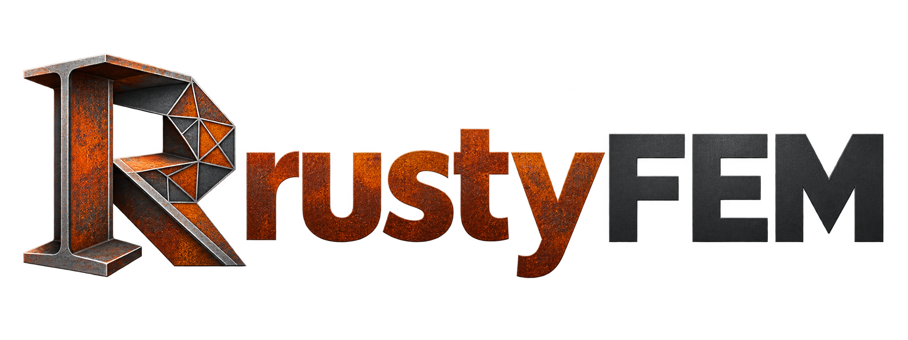

# RustyFEM



**RustyFEM is a finite element analysis (FEM) program written in Rust.** It
computes how structures and components deform, which stresses develop and
how they vibrate, heat up or fail – from a simple cantilever beam to
nonlinear models with contact, plasticity and large deformations.

The project consists of two parts:

- **The engine** – a standalone FEM solver with its own sparse equation
  solvers. The engine has no external dependencies and can be used as a
  command-line program, as a Rust library or through a C interface.
- **The desktop app** – a graphical interface for building the model, solving
  it and inspecting the results in 3D. The app runs on Windows, macOS and
  Linux; iPad and iPhone are prepared.

> [!WARNING]
> **Not for real-world design.** RustyFEM is a tool for education, research
> and development. The results may contain errors and are provided without
> any warranty. Do not use them as the basis for designing or approving real
> structures. See the [disclaimer](DISCLAIMER.md).

## Why RustyFEM?

- **Quick to get started.** A model can be described in a few lines of the
  built-in `.rusty` scripting language – geometry, mesh, material, supports
  and loads – or built directly in the app.
- **Clear error messages.** Instead of cryptic numerical errors you get a
  plain-language explanation, e.g. *"node 5 at (1, 0, 0) can move freely in
  ux – add a support"*.
- **Broad feature set.** Solids, shells, beams and trusses; linear and
  nonlinear materials; statics, dynamics, natural frequencies, buckling, heat
  transfer, acoustics, contact and explicit dynamics.
- **In-house solver technology.** A multifrontal direct solver with nested
  dissection and parallelism on all cores, plus iterative and indefinite
  solvers for large or difficult problems.
- **Open to extensions.** Custom material and element routines can be plugged
  in as shared libraries, and the core is designed to be extended area by
  area.
- **Import of existing models.** Input files in `.inp` format can be opened
  directly.

## An example

A cantilever in plane stress, clamped at one end and loaded at the other:

```text
# Cantilever in plane stress
material steel E=210e9 nu=0.3
plate x=0..2 y=0..0.2 t=0.01 size=0.025
fix x=0
load x=2 fy=-1000
```

```bash
rustyfem examples/cantilever_plate.rusty
```

Five lines make a complete analysis. The program prints the maximum
displacement, the highest von Mises stress, the sum of the reaction forces and
an equilibrium check, and the full field is saved for visualization. More
examples are in [`examples/`](examples).

## Getting started

**Requirements:** [Rust](https://www.rust-lang.org/tools/install) (stable)
and, for the app, [Node.js](https://nodejs.org/) 20 or later.

**The command-line program**

```bash
cargo build --release
./target/release/rustyfem examples/cantilever_plate.rusty
./target/release/rustyfem list     # supported elements, keywords, steps and solvers
```

**The desktop app**

```bash
cd web
npm install
npm run tauri dev                  # development mode
npm run tauri build                # installer for the current platform
```

## File formats

| File | Contents |
|---|---|
| `.rusty` | RustyFEM's scripting language for models: geometry, mesh, material, supports and loads |
| `.rustyproj` | Project file from the app: the model, the edits, the unit system and the results in one file |
| `.inp` | Input files in .inp format (keyword-based), for importing existing models |

## Project structure

| Directory | Contents |
|---|---|
| [`src/`](src) | The engine: elements, materials, analysis steps, contact and solvers |
| [`app/`](app) | The app core (`app/session`) and the desktop shell (`app/src-tauri`) |
| [`web/`](web) | The user interface (React, TypeScript and three.js) |
| [`ffi/`](ffi) | C interface to the engine's equation solvers |
| [`examples/`](examples) | Example models in `.rusty` and examples of the Rust API |
| [`docs/`](docs) | Technical reference |

The tests and the more than 1,500 regression cases live in a separate test
project.

## Documentation

- [Technical reference](docs/REFERENCE.md) – the scripting language, the
  command line, all elements, materials and analysis types, the solvers and
  known limitations.
- [Architecture](ARCHITECTURE.md) – how the engine is structured and how new
  elements, materials and steps are added.
- [The app](app/README.md) – the parts of the interface and how the app is
  built.

## License

RustyFEM is open source and licensed under either of

- Apache License, Version 2.0 ([LICENSE-APACHE](LICENSE-APACHE)), or
- MIT license ([LICENSE-MIT](LICENSE-MIT))

at your option.

Copyright © 2026 Nick Westin. Third-party software is covered by its own
licenses, see [THIRD_PARTY_LICENSES.md](THIRD_PARTY_LICENSES.md).

The program is provided without warranty and must not be used for the design
of real structures – see [DISCLAIMER.md](DISCLAIMER.md).

### Contribution

Contributions are welcome. Unless you explicitly state otherwise, any
contribution intentionally submitted for inclusion in the work by you, as
defined in the Apache-2.0 license, shall be dual licensed as above, without
any additional terms or conditions.
