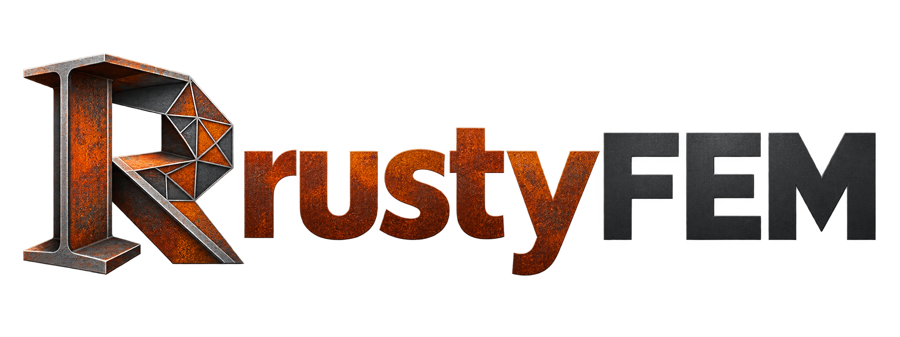

# RustyFEM – teknisk referens



En FEM-lösare skriven i Rust; motorn har inga externa beroenden. Den läser
både ett eget enkelt skriptspråk (`.rusty`) och indatafiler i
`.inp`-format, och är byggd från öppen FEM-teori. Kärnan är byggd för att
byggas ut område för område (element, material, steg-typer, nyckelord,
interaktioner, lösare) – se [ARCHITECTURE.md](../ARCHITECTURE.md).

## Snabbstart

```bash
cargo build --release
./target/release/rustyfem examples/konsol_platta.rusty
```

```text
# Konsol i plan spänning
material steel E=210e9 nu=0.3
plate x=0..2 y=0..0.2 t=0.01 size=0.025
fix x=0
load x=2 fy=-1000
```

Fem rader blir en färdig analys. Utskriften visar största förskjutning, högsta
von Mises-spänning, summan av reaktionskrafterna och en jämviktskontroll. Hela
fältet skrivs till `konsol_platta.vtk`, som kan öppnas i ParaView.

## Arbetsflödet i `.rusty`

- `plate`, `box`, `beam`, `truss`: en rad skapar, meshar och placerar geometrin.
- `size=` på geometrin styr nätet; elementtypen väljs efter geometri och modelltyp.
- Urval görs direkt med geometri: `x=0`, `y=0..0.1`, `at=(2,0)`, `all`.
- Noder på samma plats slås ihop automatiskt (en balk på en platta fungerar direkt).
- `load` anger **totalkraften**, som fördelas konsistent över valda kanter och ytor.
- Ett linjärt statiskt steg med förskjutning, reaktioner och spänning; andra
  analystyper körs via indatafiler i `.inp`-format.
- Fel rapporteras i klartext, t.ex. *"nod 5 vid (1, 0, 0) kan röra sig fritt i
  ux – lägg till stöd"*.

## Kommandon (`.rusty`)

En rad per kommando. `#` inleder en kommentar. Enheterna väljer du själv men
de måste vara konsekventa: SI (m, N, Pa) eller mm, N, MPa.

| Kommando | Exempel |
|---|---|
| `model 2d\|3d` | Valfritt; annars avgörs det av geometrin (`box` och 3D-punkter ger 3D) |
| `plane strain\|stress` | Plant töjnings- respektive spänningstillstånd i 2D (standard: stress) |
| `elements quad\|tri` | Elementform för 2D-ytor (standard: quad) |
| `material NAMN E= nu= rho=` | `material steel` och `material aluminium` har färdiga värden |
| `plate x=a..b y=c..d t= size=` | Rektangulär platta |
| `quad (x,y) (x,y) (x,y) (x,y) t= size=` | Godtycklig fyrhörning med strukturerad mesh |
| `box x= y= z= size=` | Rätblock med C3D8-element |
| `beam P1 P2 [P3 ...] section= [n=10] [up=(0,0,1)]` | Balk eller ram genom punkterna |
| `truss P1 P2 [P3 ...] area=` | Stänger mellan punkterna |
| `fix URVAL` | Inspänning: alla frihetsgrader låsta |
| `pin URVAL` | Led: translationer låsta |
| `support URVAL ux uy=0.002 rz` | Valda frihetsgrader, med föreskrivet värde om det anges |
| `load URVAL fx= fy= fz= mx= my= mz=` | Total kraft och totalt moment |
| `pressure URVAL p=` | Normaltryck på randkanter/randytor (positivt trycker in i materialet) |
| `gravity [g=9.81]` eller `gravity (gx,gy,gz)` | Egenvikt; kräver `rho` på materialet |

**Urval:** `x=0`, `x=0..1 y=0.5` (villkoren kombineras), `at=(2,0)` (en punkt)
och `all`.

**Tvärsnitt:** `rect(b,h)`, `circle(r)`, `pipe(r,t)`, `ibeam(h,b,tf,tw)` och
`general(A,I11,I22,J)`. Höjden `h` ligger i y-led i 2D och i z-led i 3D. För
vertikala balkar i 3D ligger den i x-led, om inte `up=` anges.

Geometrin används som material det senast definierade materialet, eller
`material=NAMN`. Utan något materialkommando blir det stål.

## Kommandoraden

```bash
rustyfem modell.rusty                       # analys + modell.vtk
rustyfem run modell.rusty --csv noder.csv   # även nodresultat som CSV
rustyfem modell.inp                         # kör en indatafil i .inp-format
rustyfem run modell.inp --out res.txt       # alla steg och frames som text (rustyfem-res 1)
rustyfem run modell.inp --solver iterative  # välj ekvationslösare
rustyfem run sub.inp --global global.res    # submodell mot globalmodellens resultat
rustyfem run ny.inp --oldjob gammal         # omstart från gammal.rfres
rustyfem check tests/cases/static/fall.inp  # kör ett regressionsfall och jämför med fall.ref
rustyfem check --all                        # alla regressionsfall, med tabell
rustyfem baseline tests/cases/static/fall.inp  # skriv om fall.ref från RustyFEM
rustyfem list                               # registrerade element, nyckelord, steg, lösare
```

`RUSTYFEM_USER=sökväg` laddar ett delat bibliotek med användarrutiner
(`umat_`, `uel_`, `dload_`, ...). Med `*NODE PRINT`,
`*EL PRINT` eller `*ENERGY PRINT` skriver `rustyfem run` även `jobb.dat`.

## Funktioner per område

Indatafiler i `.inp`-format läses direkt. Okända nyckelord ger en
varning; nyckelord som påverkar resultatet men inte stöds ger ett tydligt fel.
`rustyfem list` skriver ut allt som är registrerat (element, nyckelord,
steg-typer, material och lösare).

### Modell och indata

| Område | Stöd |
|---|---|
| Geometri | `*NODE`, `*ELEMENT` (även fortsättningsrader, TYPE=Un för användarelement, TYPE=Zn för substrukturer), `*NSET`/`*ELSET` (GENERATE, INSTANCE=, set i dataraderna), `*SURFACE` (elementytor S1..S6/SPOS/SNEG – SPOS/SNEG på stela element, skal och membran med normalen från nodordningen –, TYPE=NODE med nodareor, analytiska stela ytor TYPE=SEGMENTS/CYLINDER/REVOLUTION) |
| Normaler | Skal- och balknormaler medelvärdesbildas i noder där elementen skiljer < 20° (används av S8R); `*NORMAL` går före medelvärdet |
| Parter | `*PART`, `*ASSEMBLY`, `*INSTANCE` med förflyttning och rotation, referenser `Instans.nod` och `Instans.set`; `*RIGID BODY`, analytiska ytor och `*NORMAL` även inne i en `*PART` |
| Tvärsnitt | `*SOLID SECTION` (även ORIENTATION=, REF NODE= för CPEG och infinita akustiska element), `*SHELL SECTION` (även ORIENTATION= och COMPOSITE med samma material i alla skikt), `*SHELL GENERAL SECTION`, `*MEMBRANE SECTION`, `*BEAM SECTION` (RECT, CIRC, PIPE, THICK PIPE, BOX, I, L, HEX, TRAPEZOID, ARBITRARY), `*BEAM GENERAL SECTION` (GENERAL, RECT, CHANNEL, HAT, NONLINEAR GENERAL med `*AXIAL`/`*M1`/`*M2`/`*TORQUE` m.fl., DENSITY=), `*TRANSVERSE SHEAR STIFFNESS`, `*COHESIVE SECTION`, `*GASKET SECTION` |
| Randvillkor | `*BOUNDARY` i modelldata och steg, alla typnamn (ENCASTRE, PINNED, XSYMM, ...), föreskrivna värden, OP=NEW/MOD, frihetsgrad 8 (porvattentryck, akustiskt tryck), 9 (elektrisk potential) och 11 (temperatur, koncentration); USER (DISP) och SUBMODEL |
| Laster | `*CLOAD`; `*DLOAD` P/P1–P6, BX/BY/BZ/BR, GRAV, CENTRIF, PX/PY/PZ/P1/P2 på balkar, PI/PE på rör, PnNU (DLOAD); `*DSLOAD`; följande tryck vid NLGEOM; `*AMPLITUDE` (TABULAR, EQUALLY SPACED, PERIODIC, SMOOTH STEP, DECAY, USER) |
| Begynnelsevillkor | `*INITIAL CONDITIONS` TYPE=TEMPERATURE, VELOCITY, STRESS (även GEOSTATIC och USER), RATIO, PORE PRESSURE, FIELD, CONCENTRATION, SPECIFIC ENERGY, ENRICHMENT, ACOUSTIC STATIC PRESSURE; fältvariabler med `*FIELD` (även USER) |
| Parametrar | `*PARAMETER` med Python-uttryck (aritmetik, `math`-funktioner) och `<namn>` i nyckelordsrader och datarader |
| Steg | Flera `*STEP` i följd med regler för ärvda laster och randvillkor, PERTURBATION, `*CONTROLS` (PARAMETERS=FIELD, TIME INCREMENTATION), `SOLVER=`/`UNSYMM=` |
| Omstart och import | `*RESTART, WRITE/READ` (`--oldjob`, binär omstartfil `jobb.rfres`), `*IMPORT` från en tidigare analys, även från explicit till implicit analys (UPDATE=) |
| Submodellering | `*SUBMODEL` och `*BOUNDARY, SUBMODEL` (nodbaserad; globalmodellen med `--global`, från `--out`-fil eller omstartfil) |
| Substrukturer och matriser | `*SUBSTRUCTURE GENERATE` (Guyan, `*RETAINED NODAL DOFS`) och användning som TYPE=Zn med `*SUBSTRUCTURE PROPERTY`; `*MATRIX GENERATE`/`*MATRIX OUTPUT` (`.mtx`), `*MATRIX INPUT`/`*MATRIX ASSEMBLE` |
| Utdata | `--out` (alla steg och frames som text), VTK, CSV; `*NODE PRINT`, `*EL PRINT` och `*ENERGY PRINT` till `jobb.dat`; övriga utdatanyckelord godtas (RustyFEM skriver alltid U, RF, S, E, ... och områdets fält) |
| Övrigt | `*INCLUDE`, `*HEADING` |

### Element

Elementnamnen följer `.inp`-formatets namnkonvention:

| Element | Formulering |
|---|---|
| CPS4 | Bilinjär fyrhörning, full 2×2-integrering |
| CPE4 | Full integrering med B-bar, där den plana volymtöjningen ε11+ε22 medelvärdesbildas och ε33 = 0 behålls (selektivt reducerad integrering) |
| C3D8 | Full 2×2×2-integrering med B-bar, där volymtöjningen medelvärdesbildas över elementet |
| CPS3, CPE3 | Konstant töjning |
| C3D4, C3D10, C3D6, C3D15, C3D20, C3D20R | Isoparametriska tetraedrar, kilar och 20-nodshexaedrar med elementens standardintegrationsregler (`elements/solid_higher.rs`) |
| C3D10M | Modifierad tetraeder (`elements/solid_modified.rs`): fyra hexaedrar med likformig töjning, intern nod, diagonal massa och förstärkt stabilisering |
| C3D8R, CPS4R, CPE4R, CAX4R | En punkt (uniform strain) med hourglass-styvhet |
| C3D8I, CPS4I, CPE4I, CAX4I | Inkompatibla moder, kondenserade på elementnivå; vid NLGEOM i inkrementell form (`elements/solid_higher_incompat.rs`) |
| CPS6, CPE6, CPS8, CPE8, CPS8R, CPE8R | Andra ordningens plana element |
| CAX3, CAX4, CAX6, CAX8, CAX8R | Axisymmetriska element (`elements/axisym.rs`) |
| CGAX3, CGAX4, CGAX6, CGAX8, CGAX8R | Generaliserade axisymmetriska element med vridning (frihetsgrad 5, `elements/elements3_cgax.rs`) |
| C3D8H, C3D6H, C3D10H, C3D15H, C3D20H, C3D20RH, CPE3H, CPE4H, CPE6H, CPE8H, CPE8RH, CAX3H, CAX4H, CAX6H, CAX8H, CAX8RH | Hybridelement (`elements/hybrid.rs`): tre-fältsformulering (u, p, θ) med konstant (C3D8H, C3D6H, C3D10H, CPE3H, CPE4H, CAX3H, CAX4H) eller linjärt tryck per element, kondenserat på elementnivå; helt inkompressibla material (D1 = 0, ν = 0,5) vid NLGEOM med trycket som Lagrangemultiplikatorer på interna noder. C3D8H/CPE4H/CAX4H har F-bar och volymtimglasstyvhet som C3D8/CPE4/CAX4 och räknas för andra material än hyperelastiska som C3D8/CPE4/CAX4; geometrisk styvhet i `*BUCKLE` |
| C3D4H | Hybridtetraeder med kontinuerligt nodvis tryckfält (trycknoder, indefinit lösare) och stabilisering (`elements/hybrid_tet.rs`) |
| C3D8RH, CPE4RH, CAX4RH, CPEG3H, CPEG4H, CPEG4RH, CPEG6H, C3D10MH | Hybridvarianter som räknas som grundelementet (kondenserad styvhet, `elements/hybrid2.rs`); ν = 0,5 som 0,4999999 |
| CPEG3, CPEG4, CPEG4R, CPEG4I, CPEG6, CPEG8, CPEG8R | Generaliserad plan töjning med referensnod (`elements/solid_higher_gps.rs`); NLGEOM för CPEG3/6/8/8R |
| S4R | Plant fyrnodsskal (6 frihetsgrader per nod): enpunktsintegrering med timglasstabilisering, antagen tvärskjuvning (MITC4-typ), drillstyvhet. Med olinjärt material, *ORIENTATION eller skiktat tvärsnitt integreras tvärsnittet i sektionspunkter (Simpson, 5 punkter som standard; `elements/shell_section.rs`) |
| S4 | Som S4R men full 2×2-integrering av böjningen och antagen membrantöjning; integrering genom tjockleken som S4R |
| S3, S3R | Treknutsskal: CST-membran, konstant krökning, kantbaserad konstant tvärskjuvning med stabilisering, drill; integrering genom tjockleken som S4R |
| S8R | Åttanodigt dubbelkrökt tjockt skal (6 frihetsgrader per nod, `elements/shell2_s8r.rs`): serendipity-interpolation med nodnormaler, 2×2-integrering, tvärskjuvning med slankhetskompensation per integrationspunkt, drill per nod och krökningstermer; konsistent massa (3×3) med rotationströghet för alla tre rotationer |
| S4R5, S8R5, S9R5, STRI3, STRI65 | Tunna skal (`elements/shell3*.rs`, `elements3_stri65.rs`): S4R5, S8R5 (intern mittnod), S9R5 och STRI65 med fem frihetsgrader per nod och Kirchhoffvillkoret som straff; STRI3 som diskret Kirchhofftriangel (DKT) med drill. |
| SC8R, SC6R | Kontinuumskal (bara förskjutningar, tjockleken ur noderna, `elements/shell2_sc.rs`): mittyta och direktör ur under-/översidans noder, S4R- respektive S3R-formulering utan drill, tjocklekstöjning med tjockleksmodulen 2G (eller `THICKNESS MODULUS=`) och Poissontöjningen för POISSON = 0,5 |
| SAX1, SAX2, MAX1, MAX2 | Axisymmetriska skal och membran (`elements/shell3_axi.rs`) |
| SAXA11–SAXA14, SAXA21–SAXA24 | Axisymmetriska skal med asymmetrisk deformation (Fouriermoder, linjärt elastiska, `elements/elements3_saxa.rs`) |
| M3D4, M3D3 | Membran (`*MEMBRANE SECTION`) |
| B23, B33 (B23H, B33H) | Euler–Bernoulli-balk (kubisk, två inre axiella frihetsgrader per element), SF/SM i tre integrationspunkter. |
| B21, B22, B31, B32 (B21H, B22H, B31H, B32H) | Timoshenkobalk (linjär/kvadratisk, reducerad integrering, slankhetskompensation); utdata SF/SM. Med olinjärt material (*PLASTIC, *EXPANSION) och *BEAM SECTION integreras tvärsnittet i sektionspunkter (RECT 5×5, CIRC 17, PIPE 8, BOX 16, I 13; L och ARBITRARY; plana balkar 5 genom höjden; `elements/beam_timoshenko_plastic.rs`) med utdata S11 och PEEQ. Hybridbalkarna har skjuvstyvheten (1 + 10⁻⁶) gånger större |
| B31OS, B32OS | Öppna tunnväggiga balkar med välvning (frihetsgrad 7), BIMOM (`elements/beams2_open.rs`) |
| PIPE21, PIPE22, PIPE31, PIPE32 | Rörelement: Timoshenkobalk med ringtöjning på interna noder, inre/yttre tryck PI/PE med ändlockskraft (`elements/pipe.rs`) |
| T2D2, T3D2 | Stång |
| COH2D4, COHAX4, COH3D8, COH3D6 | Kohesiva element med traction–separation (`elements/cohesive.rs`), även NLGEOM; utdata S, E (logaritmisk töjning vid NLGEOM), SDEG, initieringskriterier, STATUS |
| GK3D8, GK3D6, GKPE4, GKAX4, GK2D2, GKAX2, GK3D2 (och N-varianterna) | Packningselement med tjockleksbeteende, membran och tvärskjuvning (`elements/gasket.rs`) |
| CINPE4, CINPS4, CINAX4, CIN3D8 | Infinita element (statik; ingen styvhet eller massa i *FREQUENCY; `elements/infinite.rs`) |
| CPE4P, CPE8P, CPE8RP, CAX4P, CAX8P, CAX8RP, C3D8P, C3D20P, C3D20RP | Porvattentryck–förskjutning (*SOILS), porvattentrycket i hörnnoderna (`elements/soils.rs`) |
| DC2D3, DC2D4, DC2D8, DCAX3, DCAX4, DCAX8, DC3D4, DC3D6, DC3D8, DC3D10, DC3D20 | Värmeledning och masstransport; första ordningens element har diagonal kapacitet |
| DC2D3E, DC2D4E, DC2D8E, DCAX4E, DC3D4E, DC3D8E, DC3D20E | Kopplad termisk-elektrisk ledning (frihetsgrad 9 och 11) |
| C3D8E, C3D20E, CPE4E, CPS4E | Piezoelektriska element (förskjutningar och potential; utdata S, E, EFLX, EPG) |
| C3D8T, CPE4T, CPS4T, CAX4T, CPE3T, CPS3T, C3D4T | Kopplad temperatur–förskjutning: mekaniskt som grundelementen, termiskt som DC-elementen; CPE3T/CPS3T/C3D4T i explicit kopplad analys |
| AC2D3, AC2D4, AC2D8, ACAX3, ACAX4, ACAX8, AC3D4, AC3D6, AC3D8, AC3D10, AC3D20 | Akustiska element (tryck POR, frihetsgrad 8, `elements/acoustic.rs`) |
| AC2D4R, AC3D8R, ACAX4R | Akustiska element för explicit dynamik med diagonal massa |
| PC3D | SPH-partiklar (explicit dynamik), massa ρ(2L)³ från `*SOLID SECTION` (`steps/explicit_adv_sph.rs`) |
| PD3D | Diskreta partiklar (DEM, stela sfärer med rotation) från `*DISCRETE SECTION` (`steps/explicit_adv_dem.rs`) |
| EC3D8R | Euler-element med flera material och tomrum, `*EULERIAN SECTION` (`steps/explicit_adv_euler.rs`) |
| ACIN2D2, ACIN2D3, ACIN3D3, ACIN3D4, ACIN3D6, ACIN3D8, ACINAX2, ACINAX3 | Akustiska infinita element (Astleys konjugerade element med tio radiella funktioner, `elements/acoustic_infinite.rs`) |
| XFEM (`*ENRICHMENT`) | Berikade C3D8, C3D8R, C3D4, CPE4 och CPS4: Heaviside med fantomnoder, spetsfunktioner för stationära sprickor, sprickväxt ett elementlager per inkrement med kohesiv lag (`elements/xfem.rs`) |
| SPRING1, SPRING2, SPRINGA, DASHPOT1, DASHPOT2, DASHPOTA, MASS, ROTARYI, CONN2D2, CONN3D2 | Fjädrar, dämpare, punktmassor och kopplingselement (`elements/point.rs`, `interactions/`) |
| R3D4, R3D3, R2D2, RAX2 | Stela element (`elements/rigid.rs`): ingen styvhet eller massa, noderna följer referensnoden i `*RIGID BODY`; ytor med SPOS/SNEG som stela masterytor i kontakt |
| Un (`*USER ELEMENT`) | Användarelement med UEL-gränssnittet (`elements/user_element.rs`, `user/uel.rs`): NODES, COORDINATES, PROPERTIES, I PROPERTIES, VARIABLES, UNSYMM, aktiva frihetsgrader per nod, `*UEL PROPERTY` |
| Zn | Matriselement: substrukturer från `*SUBSTRUCTURE GENERATE` och matriser från `*MATRIX INPUT` (`elements/matrix_element.rs`) |

### Material

| Område | Stöd |
|---|---|
| Elasticitet | `*ELASTIC` isotrop (även temperatur- och fältberoende, DEPENDENCIES=; ν = 0,5 i hybridelement), TYPE=ENGINEERING CONSTANTS/ORTHOTROPIC/ANISOTROPIC/LAMINA/TRACTION; `*ORIENTATION` (RECTANGULAR, CYLINDRICAL, extra rotation) via `ORIENTATION=` på `*SOLID SECTION` och `*SHELL SECTION` (skal: materialaxlarna i planet väljs efter den extra rotationens axel); S och E redovisas i lokala axlar; `*DENSITY` |
| Plasticitet | `*PLASTIC` von Mises: HARDENING=ISOTROPIC (tabell, även temperaturberoende), KINEMATIC (linjär), COMBINED med DATATYPE=PARAMETERS och NUMBER BACKSTRESSES (Chaboche), JOHNSON COOK, USER (UHARD), `*CYCLIC HARDENING`; radial return med konsistent tangent; utdata PEEQ och PE; i skal (plan spänning per sektionspunkt) och i Timoshenkobalkar (enaxligt per sektionspunkt), med och utan NLGEOM |
| Metallplasticitet | Hills anisotropa flytvillkor (`*POTENTIAL`, även temperaturberoende), flytkurvor per töjningshastighet (`*PLASTIC, RATE=`), `*RATE DEPENDENT` (POWER LAW, JOHNSON COOK, YIELD RATIO), von Mises med anisotrop elasticitet; även med kinematiskt hårdnande, *ORIENTATION och NLGEOM |
| Drucker–Prager | `*DRUCKER PRAGER` SHEAR CRITERION=LINEAR (även K ≠ 1), HYPERBOLIC och EXPONENT FORM med `*DRUCKER PRAGER HARDENING` TYPE=COMPRESSION/TENSION/SHEAR; Cap-modellen `*CAP PLASTICITY` med `*CAP HARDENING`; den osymmetriska tangenten assembleras helt med `*STEP, UNSYMM=YES` |
| Mohr–Coulomb | `*MOHR COULOMB` (φ, ψ, DEVIATORIC ECCENTRICITY=) med `*MOHR COULOMB HARDENING` och `*TENSION CUTOFF` (Rankine-yta); Menétrey–Willams släta flödespotential, retur i huvudspänningsrummet inklusive hörn och spets; numerisk osymmetrisk tangent; utdata PEEQ och PE |
| Cam-clay | `*CLAY PLASTICITY` (även TABULAR) med `*CLAY HARDENING` och porös elasticitet `*POROUS ELASTIC` |
| Betong | Skadeplasticitet: `*CONCRETE DAMAGED PLASTICITY` med `*CONCRETE COMPRESSION HARDENING`, `*CONCRETE TENSION STIFFENING` (STRAIN/DISPLACEMENT/GFI), `*CONCRETE COMPRESSION DAMAGE` och `*CONCRETE TENSION DAMAGE`; Lee–Fenves med styvhetsåterhämtning och viskös regularisering; utdata PEEQ, PEEQT, PE, DAMAGEC, DAMAGET, SDEG. Utsmetad sprickbildning: `*CONCRETE` med `*TENSION STIFFENING`, `*SHEAR RETENTION` och `*FAILURE RATIOS` |
| Duktil skada | `*DAMAGE INITIATION, CRITERION=DUCTILE`, `SHEAR` och `JOHNSON COOK` med `*DAMAGE EVOLUTION` TYPE=DISPLACEMENT (LINEAR/EXPONENTIAL/TABULAR) eller ENERGY (LINEAR/EXPONENTIAL), DEGRADATION=MAXIMUM/MULTIPLICATIVE, ovanpå `*PLASTIC`; DUCTILE/SHEAR med töjningshastighets- och temperaturberoende tabeller; Hillerborg med elementets karakteristiska längd; elementborttagning (`*SECTION CONTROLS, ELEMENT DELETION=, MAX DEGRADATION=`) och STATUS; utdata DUCTCRT, SHRCRT, SDEG |
| Kohesiv | `*ELASTIC, TYPE=TRACTION` med `*DAMAGE INITIATION` MAXS/QUADS/MAXE/QUADE och `*DAMAGE EVOLUTION` TYPE=DISPLACEMENT/ENERGY (även blandad mod), viskös regularisering; samma lag på XFEM-sprickytor (även MAXPS, MAXPE, `*DAMAGE STABILIZATION`) |
| Packningar | `*GASKET BEHAVIOR` med `*GASKET THICKNESS BEHAVIOR` (pålastningskurva) och `*GASKET ELASTICITY` |
| Termisk töjning | `*EXPANSION` (ISO/ORTHO/ANISO, ZERO=, α(T)-tabell, USER); `*INITIAL CONDITIONS, TYPE=TEMPERATURE`, `*TEMPERATURE` (data, OP=NEW/MOD, rampas över steget, eller FILE=jobb där värmeanalysen körs med RustyFEM); för skal även temperaturgradienten genom tjockleken; medeltemperaturen per element |
| Hyperelasticitet | `*HYPERELASTIC` NEO HOOKE, MOONEY-RIVLIN, YEOH, POLYNOMIAL, REDUCED POLYNOMIAL, OGDEN (N ≤ 6), ARRUDA-BOYCE, VAN DER WAALS; TEST DATA INPUT med `*UNIAXIAL`/`*BIAXIAL`/`*PLANAR`/`*VOLUMETRIC TEST DATA` för polynomformerna och ARRUDA-BOYCE (μ, λm anpassade med minsta kvadrat); kompressibla (D1 > 0) i alla kontinuumelement, helt inkompressibla (D1 = 0) i hybridelementen; kräver NLGEOM=YES |
| Krossbart skum | `*CRUSHABLE FOAM`, HARDENING=VOLUMETRIC (k, kt) och ISOTROPIC (k, νp) med `*CRUSHABLE FOAM HARDENING` och `*ELASTIC`; utdata PEEQ, PE |
| Porösa metaller | `*POROUS METAL PLASTICITY` (Gurson–Tvergaard–Needleman, q1–q3, RELATIVE DENSITY=) ovanpå `*PLASTIC`, `*VOID NUCLEATION`, `*POROUS FAILURE CRITERIA`, `*INITIAL CONDITIONS, TYPE=RELATIVE DENSITY`; utdata PEEQ, PE, VVF, VVFG, VVFN |
| Deformationsplasticitet | `*DEFORMATION PLASTICITY` (Ramberg–Osgood, totalformulering); utdata PE, PEEQ |
| Kompositskada | `*ELASTIC, TYPE=LAMINA` med `*DAMAGE INITIATION, CRITERION=HASHIN` (ALPHA=), `*DAMAGE EVOLUTION, TYPE=ENERGY` och `*DAMAGE STABILIZATION` i CPS-element och skal; utdata DAMAGEFT/FC/MT/MC, DAMAGESHR, HSNFTCRT/FCCRT/MTCRT/MCCRT |
| Formbarhet | `*DAMAGE INITIATION, CRITERION=FLD`, `FLSD` och `MSFLD` ovanpå `*PLASTIC` i CPS-element och skal; utdata FLDCRT, FLSDCRT, MSFLDCRT |
| Skum och Mullins | `*HYPERFOAM` (N ≤ 6, POISSON=) och `*MULLINS EFFECT` (Ogden–Roxburgh, ovanpå alla hyperelastiska former och skum; utdata SENER, DMENER) |
| Krypning | `*CREEP` LAW=TIME, STRAIN, TIME POWER LAW, POWER LAW, HYPERB, ANAND, DARVEAUX, DOUBLE POWER och USER; `*SWELLING`, anisotrop krypning med `*POTENTIAL`; temperaturberoende parametrar; tillsammans med `*PLASTIC`; explicit och implicit integration; aktiv i `*VISCO` och `*COUPLED TEMPERATURE-DISPLACEMENT`; utdata CEEQ, CE |
| Viskoelasticitet | `*VISCOELASTIC, TIME=PRONY` med isotrop `*ELASTIC` eller `*HYPERELASTIC` (stora töjningar); MODULI=LONG TERM eller INSTANTANEOUS; aktiv i `*VISCO` och `*DYNAMIC`, momentant svar i `*STATIC`, fullt relaxerat med `*STATIC, LONG TERM`; `*TRS` (WLF, ARRHENIUS, TABULAR); FREQUENCY=PRONY/TABULAR i `*STEADY STATE DYNAMICS, DIRECT` |
| Tillståndsekvationer | `*EOS` TYPE=USUP, IDEAL GAS, TABULAR och JWL (`*DETONATION POINT`), `*EOS COMPACTION` (P-α), `*TENSILE FAILURE`, `*INITIAL CONDITIONS, TYPE=SPECIFIC ENERGY` (explicit dynamik) |
| Porvätska | `*PERMEABILITY` (portalsberoende), `*POROUS BULK MODULI` |
| Akustiskt medium | `*ACOUSTIC MEDIUM`: kompressionsmodul, VOLUMETRIC DRAG, COMPLEX BULK MODULUS/COMPLEX DENSITY, POROUS MODEL=DELANY BAZLEY/MIKI, CAVITATION LIMIT |
| Multifysik | `*ELECTRICAL CONDUCTIVITY`, `*JOULE HEAT FRACTION`, `*PIEZOELECTRIC`, `*DIELECTRIC`, `*DIFFUSIVITY`, `*SOLUBILITY` |
| Dämpning | `*DAMPING` (Rayleigh ALPHA/BETA, STRUCTURAL) i dynamiksteg |
| Värme | `*CONDUCTIVITY`, `*SPECIFIC HEAT` (temperaturberoende), `*LATENT HEAT`, `*HEAT GENERATION` (HETVAL) |
| Fältvariabler | Materialdata med DEPENDENCIES= mot fältvariabler från `*INITIAL CONDITIONS, TYPE=FIELD`, `*FIELD` (UFIELD) eller `*USER DEFINED FIELD` (USDFLD) |
| Användarmaterial | `*USER MATERIAL` med UMAT (TYPE=MECHANICAL, även UNSYMM), UMATHT (TYPE=THERMAL) och VUMAT (explicit dynamik), se Användarrutiner |

### Analystyper (steg)

| Steg | Stöd |
|---|---|
| Linjär statik | `*STATIC` (även DIRECT, PERTURBATION, inkrementdata); Newton–Raphson med automatisk inkrementering och konvergenskriterier av standardtyp för olinjära material, kontakt och NLGEOM; krypning ignoreras och viskoelasticitet ger momentant svar (LONG TERM: fullt relaxerat); obalanskorrektion för begynnelsespänningar |
| Stabilisering | `*STATIC, STABILIZE` (FACTOR=, dissiperad energifraktion, ALLSDTOL=, CONTINUE=) med och utan NLGEOM och kontakt; utdata VF och ALLSD |
| Borttagna element | `*MODEL CHANGE, REMOVE/ADD` (STRAIN FREE, WITH STRAIN) för element och kontaktpar |
| Kvasistatik med tidsberoende material | `*VISCO` med eller utan NLGEOM: fasta inkrement eller automatisk inkrementering med CETOL, stabilitetsgräns och byte till implicit krypintegration, CREEP=EXPLICIT |
| Geometrisk olinjäritet | `*STEP, NLGEOM=YES` med `*STATIC` (automatisk inkrementering eller DIRECT) och `*STATIC, RIKS` (även DIRECT, slut vid λ eller nodförskjutning); utdata logaritmisk töjning och Cauchy-spänning S. Element: kontinuumelementen (även CPEG3/6/8/8R och inkompatibla moder; inte C3D10M och CPEG4/4R), stänger, balkar, skal (S4/S4R/S3/S3R korotationellt med logaritmisk membrantöjning, S8R/SC8R/SC6R korotationellt med Green-membrantöjning), membran och kohesiva element; tryck på skal och membran följer ytan, plasticitet med roterad plastisk töjning och mottensor. Tangenter som inte är positivt definita löses med den indefinita LDLᵀ-lösaren |
| Egenfrekvenser | `*FREQUENCY` (LANCZOS/SUBSPACE/AMS-dataraderna: antal, frekvensintervall, skift; NORMALIZATION, SIM=NO); utdata per mod U, RF, S, EIGVAL, EIGFREQ, GM, PF1–PF6, EM1–EM6 |
| Komplexa egenvärden | `*COMPLEX FREQUENCY` på moderna från föregående `*FREQUENCY`, med dämpare och materialets *DAMPING |
| Knäckning | `*BUCKLE` (SUBSPACE/LANCZOS) med förlast från föregående steg, K_σ med Jaumann-korrektion, lastyvhet från följande tryck |
| Implicit dynamik | `*DYNAMIC` (HHT-α med standardparametrar för APPLICATION=TRANSIENT FIDELITY/MODERATE DISSIPATION, ALPHA/BETA/GAMMA; QUASI-STATIC och BWE), fasta eller automatiska inkrement (`steps/dynamic_incr.rs`: HAFTOL/HALFINC SCALE FACTOR, INCREMENTATION=CONSERVATIVE/AGGRESSIVE, inkrementen träffar utdatatidpunkter); `*TIE`/MPC/`*EQUATION`, stela kroppar (även NLGEOM), kopplingselement och kontakt; `*INITIAL CONDITIONS, TYPE=VELOCITY`; skal och Timoshenkobalkar med diagonal massa; `*MASS` och `*ROTARY INERTIA` |
| Explicit dynamik | `*DYNAMIC, EXPLICIT` (NLGEOM=YES som standard; C3D8R/CPE4R/CPS4R med NLGEOM har inkrementell hourglass-kontroll): centraldifferens med diagonal massa, fast Δt (`DIRECT USER CONTROL`) eller elementvis stabilitetsgräns (`IMPROVED DT METHOD` för skal och membran), `*BULK VISCOSITY`, hourglass-kontroll (`RELAX STIFFNESS`, `STIFFNESS`), `*FIXED MASS SCALING`, `*VARIABLE MASS SCALING`, `*AMPLITUDE`, energier (`*ENERGY OUTPUT`: ALLKE, ALLIE, ALLSE, ALLPD, ALLAE, ALLVD, ALLFD, ALLPW, ALLWK, ETOTAL), `*CONTACT` (general contact, även självkontakt och skal med kontakttjocklek) och `*CONTACT PAIR` med massbaserad straffkraft, Coulombfriktion och `*CONTACT DAMPING`, NLGEOM med plasticitet, `*EOS`, VUMAT, elementborttagning vid skada, kopplingselementens låsta komponenter |
| Kopplad explicit termomekanik | `*DYNAMIC TEMPERATURE-DISPLACEMENT, EXPLICIT` med CPE3T, CPS3T och C3D4T |
| SPH, DEM, Euler och ALE (explicit dynamik) | SPH med PC3D: kubisk, kvadratisk och kvintisk kärna (`*SECTION CONTROLS, KERNEL=`), standardutjämningslängd, användarangiven längd och skalfaktor, konstant eller variabel h, artificiell viskositet (UNIFORM, VORTICITY WEIGHTED), alla material (även *EOS); omvandling av C3D8R/C3D8 till partiklar i analysens början (`ELEMENT CONVERSION=YES`, PER ELEMENT med TIME 0 och BACKGROUND GRID). DEM med PD3D: `*DISCRETE SECTION` (DENSITY, ALPHA), partikelkontakt i general contact mot partiklar och elementytor (LINEAR, HERTZ med `*DISCRETE ELASTICITY`, hård straffkontakt, standarddämpning, `*CONTACT DAMPING`, Coulombfriktion med rullning), tyngdkraft. Euler (CEL) med EC3D8R: `*EULERIAN SECTION` med flera material och tomrum, `*INITIAL CONDITIONS, TYPE=VOLUME FRACTION`, Lagrangesteg och advektion (ADVECTION=FIRST/SECOND ORDER) med bevarade gränsytor, *EOS och övriga material, tyngdkraft, volymviskositet, utdata EVF_*, EVF_VOID, SVAVG, PEEQVAVG; kopplad Euler–Lagrange-kontakt i general contact (ALL EXTERIOR). ALE: `*ADAPTIVE MESH` (FREQUENCY, MESH SWEEPS, INITIAL MESH SWEEPS) med `*ADAPTIVE MESH CONTROLS` (volymetrisk och Laplace-utjämning) för C3D8R, advektion av tillstånd, massa och rörelsemängd |
| Modala metoder | `*MODAL DYNAMIC`, `*STEADY STATE DYNAMICS` (modal, DIRECT och SUBSPACE PROJECTION), `*RESPONSE SPECTRUM` (`*SPECTRUM`, SRSS/ABS/CQC/NRL/TENP), `*RANDOM RESPONSE` (`*PSD-DEFINITION`, `*CORRELATION`, lastfall) och `*DYNAMIC, SUBSPACE` med moderna från föregående `*FREQUENCY`; `*MODAL DAMPING` (VISCOUS, RAYLEIGH, STRUCTURAL), `*SELECT EIGENMODES`, `*BASE MOTION`, frekvensberoende amplituder; SSD skriver real- och imaginärdel |
| Cykliskt svar | `*DIRECT CYCLIC` (Fourierserie, stabiliserad cykel) |
| Glödgning | `*ANNEAL` (spänningsfritt tillstånd i deformerad geometri, von Mises) |
| Värmeledning | `*HEAT TRANSFER` (STEADY STATE, transient med fasta inkrement eller DELTMX=), `*CFLUX`, `*DFLUX`/`*DSFLUX` (BF, Sn, AMPLITUDE=), `*FILM`/`*SFILM` (även `*FILM PROPERTY` och FILM-rutin), `*RADIATE`/`*SRADIATE`, `*PHYSICAL CONSTANTS`, latent värme; utdata NT11, RFL11, HFL |
| Kopplad termomekanik | `*COUPLED TEMPERATURE-DISPLACEMENT` (STEADY STATE, transient med fasta inkrement eller DELTMX=), även med kontakt och `*GAP CONDUCTANCE`/`*GAP RADIATION`; termisk spänning med `*STATIC` + `*TEMPERATURE` |
| Termisk-elektrisk | `*COUPLED THERMAL-ELECTRICAL` (stationär, transient) med Joulevärme, `*CECURRENT`, `*DECURRENT`/`*DSECURRENT` |
| Piezoelektricitet | `*STATIC` och `*FREQUENCY` med piezoelektriska element, `*CECHARGE` |
| Masstransport | `*MASS DIFFUSION` (stationär, transient med fasta inkrement eller DCMAX=), `*INITIAL CONDITIONS, TYPE=CONCENTRATION` |
| Porvattentryck | `*SOILS` (stationär och CONSOLIDATION) och `*GEOSTATIC` med `*CFLOW`, `*DFLOW`/`*DSFLOW`, `*FLOW`/`*SFLOW`; utdata POR, VOIDR, RVF; begynnelsespänning, portal och porvattentryck |
| Akustik | `*FREQUENCY`, `*STEADY STATE DYNAMICS, DIRECT` och `*DYNAMIC` (även automatisk inkrementering) med akustiska element, akustisk–strukturell `*TIE`, `*IMPEDANCE`/`*SIMPEDANCE` och icke-reflekterande ränder (PLANAR, IMPROVED, CIRCULAR, SPHERICAL, ELLIPTICAL, PROLATE SPHEROIDAL); akustik i `*DYNAMIC, EXPLICIT` med kavitation |
| Brottmekanik | `*CONTOUR INTEGRAL` i `*STATIC`: J, K FACTORS (K1, K2, K3, riktning) och T-STRESS med domänintegralmetoden; även för XFEM-sprickor |
| Matriser och substrukturer | `*MATRIX GENERATE` och `*SUBSTRUCTURE GENERATE` som egna steg |
| Kavitetsstrålning | `*CAVITY DEFINITION` (sluten/öppen), `*SURFACE PROPERTY`/`*EMISSIVITY` (ε(T) explicit), `*RADIATION VIEW FACTOR` (BLOCKING, REFLECTION, VTOL, LUMPED AREA, INFINITESIMAL, INTEGRATION), `*RADIATION SYMMETRY` + `*REFLECTION`; synfaktorer 2D (korsade trådar) och 3D (kontur/Hottel/klumpad), stationär och transient `*HEAT TRANSFER` |
| Påtvingad konvektion | DCC1D2, DCCAX2, DCC2D4, DCCAX4, DCC3D8 med `*MASS FLOW RATE` och Yu–Heinrichs uppströmsviktning, stationär och transient (trapetsregel, konsistent kapacitet) |
| Lågfrekvent elektromagnetism | `*ELECTROMAGNETIC, LOW FREQUENCY, TIME HARMONIC` med EMC3D4 och EMC2D3 (Nédélec-kantelement), `*MAGNETIC PERMEABILITY`, `*ELECTRICAL CONDUCTIVITY`, `*DECURRENT` CJ; utdata EMB, EMH, EMCD, EMJH |

### Villkor, kontakt och interaktioner

`*EQUATION`, `*MPC` (BEAM, PIN, TIE), `*COUPLING` (KINEMATIC, DISTRIBUTING),
`*KINEMATIC COUPLING`, `*TIE` (NODE TO SURFACE och SURFACE TO SURFACE/mortar;
även akustisk–strukturell), `*RIGID BODY` (REF NODE, ELSET, PIN NSET, TIE
NSET, POSITION=CENTER OF MASS, DENSITY=, ANALYTICAL SURFACE=; vid NLGEOM
med ändliga rotationer, även i `*DYNAMIC`), `*SPRING`, `*MASS`, `*ROTARY
INERTIA`, `*DASHPOT`.

Kopplingselement (`*CONNECTOR SECTION`, `*CONNECTOR BEHAVIOR`): alla typer i
anslutningsbiblioteket utom ACCELEROMETER, FLOW-CONVERTER, RETRACTOR och
SLIPRING, med `*CONNECTOR ELASTICITY` (linjär, NONLINEAR, RIGID),
`*CONNECTOR DAMPING`, `*CONNECTOR PLASTICITY`/`*CONNECTOR HARDENING`,
`*CONNECTOR DAMAGE INITIATION`/`EVOLUTION`, `*CONNECTOR STOP`,
`*CONNECTOR LOCK`, `*CONNECTOR FRICTION`, `*CONNECTOR MOTION` och
`*CONNECTOR LOAD`; ändliga mått vid NLGEOM, i implicit och explicit dynamik.

Kontakt: `*CONTACT PAIR` och `*CONTACT` (general contact med
`*CONTACT INCLUSIONS`/`EXCLUSIONS` och `*CONTACT PROPERTY ASSIGNMENT`) med
nod mot yta och yta mot yta, small/finite sliding, självkontakt,
deformerbara eller stela masterytor (R3D4, R3D3, R2D2 och analytiska ytor),
HARD (även NO SEPARATION), LINEAR, PENALTY och TABULAR (`*SURFACE BEHAVIOR`),
`*FRICTION` (Coulomb, ELASTIC SLIP, ROUGH, LAGRANGE, EXPONENTIAL DECAY,
ANISOTROPIC), `*CLEARANCE`, töjningsfri justering (ADJUST=,
`*CONTACT INITIALIZATION DATA`), `*CONTACT DAMPING`, termisk kontakt
(`*GAP CONDUCTANCE`, `*GAP RADIATION`); utdata CPRESS, COPEN, CSHEAR, CSLIP.
Kohesiv kontakt: `*COHESIVE BEHAVIOR` (TYPE=UNCOUPLED, ELIGIBILITY=ORIGINAL CONTACTS) under `*SURFACE INTERACTION` med `*DAMAGE INITIATION` (MAXS, QUADS, MAXU, QUADU), `*DAMAGE EVOLUTION` och `*DAMAGE STABILIZATION` för `*CONTACT PAIR` nod mot yta; utdata CSDMG, CSMAXSCRT, CSQUADSCRT, CSMAXUCRT, CSQUADUCRT.
Vätske- och gasfyllda kaviteter: `*FLUID CAVITY` (SURFACE=, REF NODE=, ADDED VOLUME=, AMBIENT PRESSURE=) med `*FLUID BEHAVIOR` (`*FLUID DENSITY`, `*FLUID BULK MODULUS`, `*FLUID EXPANSION` eller ideal gas med `*MOLECULAR WEIGHT`, `*CAPACITY`), tryckfrihetsgrad 8 i referensnoden (även föreskriven), `*FLUID FLUX`, `*INITIAL CONDITIONS, TYPE=FLUID PRESSURE`, ytorna som F2D2/FAX2/F3D3/F3D4-delytor (andra ordningens ytor delas); implicit och explicit; utdata PCAV och CVOL (nod och history).
Linjära villkor elimineras med master–slav-transformation (`src/fem/mpc.rs`),
även vid NLGEOM; stela kroppar linjäriseras då om i varje iteration så att
stelkroppsrörelsen blir exakt.

### Ekvationslösare

Egna glesa lösare utan externa beroenden (se "Lösare och prestanda" nedan):
`direct` (multifrontal LDLᵀ, standard), `indefinite` (1×1/2×2-pivotering,
tröghet), `unsymmetric` (multifrontal LU, `*STEP, UNSYMM=YES`; även elementmatriser med
osymmetrisk materialtangent assembleras då helt med `add_unsym`), `iterative`
(PCG med algebraisk multigrid, `*STEP, SOLVER=ITERATIVE`), `iterative-ic0`
och `iterative-jacobi`. Egenvärdeslösaren är blockad subspace-iteration med
skift-invert (`src/solver/eigen.rs`); de akustiska stegen har en osymmetrisk
variant och de projicerade stegen en tät komplex QR-lösare.

## Som Rust-bibliotek

```rust
use rustyfem::{Material, Model, Sel};

let mut m = Model::new_2d();
let steel = m.material(Material::steel());
m.plate([0.0, 0.0], [2.0, 0.2], 0.01, 0.025, steel)?;
m.fix(Sel::x(0.0));
m.force(Sel::x(2.0), [0.0, -1000.0, 0.0]);
let r = m.solve()?;
println!("{}", r.summary(&m));
```

Se `examples/api_konsol.rs` (`cargo run --release --example api_konsol`).

## Användarrutiner (UMAT och UEL)

RustyFEM har de etablerade gränssnitten för användarmaterial (UMAT,
`*USER MATERIAL` + `*DEPVAR`) och användarelement (UEL, `*USER ELEMENT` +
`*UEL PROPERTY`), med standardargumentlistorna och deras semantik (se
`src/user/umat.rs` och `src/user/uel.rs`). Eftersom Rust inte kompilerar Fortran finns två vägar:

- **I Rust:** implementera `rustyfem::user::umat::Umat` (eller `uel::Uel`) och
  registrera före körningen. UMAT:en väljs med materialnamnet (längsta prefix),
  UEL:en med typnumret n i TYPE=Un:

  ```rust
  use rustyfem::user::umat::{self, Umat, UmatArgs};
  struct MinUmat;
  impl Umat for MinUmat {
      fn umat(&self, a: &mut UmatArgs) -> rustyfem::Result<()> {
          // a.stress, a.statev, a.ddsdde (kolumnvis), a.dstran, a.props, ... som i Fortran
          Ok(())
      }
  }
  umat::register("MITT_", std::sync::Arc::new(MinUmat)); // *MATERIAL, NAME=MITT_STAL
  ```

- **Delat bibliotek:** en kompilerad UMAT/UEL (Fortran eller C) som
  exporterar `umat_`/`uel_` (även `umat`, `UMAT`, `uel`, `UEL` provas) med
  standardargumentlistan i Fortrans konvention (alla argument som pekare,
  heltal som `int32`, CMNAME som 80 tecken med dold längd sist). Ange
  biblioteket med `RUSTYFEM_USER=sökväg/umat.dll` eller
  ladda det med `rustyfem::user::load_library` och registrera rutinerna.
  Biblioteket laddas med operativsystemets laddare (LoadLibraryW/dlopen) utan
  externa paket, och anropen görs ett i taget.

Exempel som följer med (`src/user/samples.rs`) och som ger samma resultat
som de inbyggda modellerna till avrundningsfel (≤ 5e-14, `tests/rigid_user.rs`):
UMAT `EXEMPEL_ELASTISK` (PROPS = E, ν) och `EXEMPEL_MISES` (PROPS = E, ν,
σy₁, ε̄p₁, σy₂, ε̄p₂, ...; STATEV(1) = PEEQ, STATEV(2..) = plastisk töjning),
UEL U9001 (stång, PROPS = E, A[, ρ]) och U9002 (fyrhörning i plan spänning
som CPS4, PROPS = E, ν, t).

**Fler rutiner.** VUMAT (`*USER MATERIAL` i `*DYNAMIC, EXPLICIT`,
`user/vumat.rs`, exempel `EXEMPEL_VELASTISK` och `EXEMPEL_VMISES`) och
rutinerna i `user/routines.rs`: DLOAD (`*DLOAD` PnNU), DISP
(`*BOUNDARY, USER`), UAMP (`*AMPLITUDE, DEFINITION=USER`), USDFLD
(`*USER DEFINED FIELD`), UFIELD (`*FIELD, USER`), UHARD
(`*PLASTIC, HARDENING=USER`), SIGINI (`*INITIAL CONDITIONS, TYPE=STRESS,
USER`), UEXPAN (`*EXPANSION, USER`), CREEP (`*CREEP, LAW=USER`), HETVAL
(`*HEAT GENERATION`), FILM (`*FILM` FnNU) och UMATHT (`*USER MATERIAL,
TYPE=THERMAL`). De väljs med längsta prefix av material-, set- eller
amplitudnamnet och skrivs som Rust-traits eller laddas från biblioteket
(`dload_`, `disp_`, `uhard_`, `sigini_`, `ufield_`, `uexpan_`, `hetval_`,
`film_`, `creep_`, `umatht_`; USDFLD och UAMP bara i Rust). Körkontexten
(`user/context.rs`) ger rutinerna KSTEP, KINC, TIME, NOEL, NPT, COORDS,
CELENT och fältvariablerna, och PNEWDT < 1 gör om inkrementet. Exempel
`EXEMPEL_*` (`user/samples2.rs`) testas i `tests/cases/user2/`.

## C-gränssnitt (`ffi/`)

`cargo build --release -p rustyfem-ffi` bygger `rustyfem_ffi.dll` (Windows) /
`librustyfem_ffi.so`/`.dylib`. De ursprungliga funktionerna `rustyfem_factor`,
`rustyfem_solve`, `rustyfem_info`, `rustyfem_order` och `rustyfem_free` har
oförändrade signaturer; `rustyfem_factor_indef`, `rustyfem_factor_unsym` och
`rustyfem_inertia` är nya (se ARCHITECTURE.md). OpenFEM
(`../openFEManalysis`, `openfem/fem/plugin_rustyfem.py`) använder biblioteket
via ctypes; `tests/fem_core/test_plugin_rustyfem.py` där går igenom (6 tester)
mot den sammanslagna koden.

## Lösare och prestanda

Ekvationssystemet löses med en egen gles direktlösare utan externa beroenden:

- **Ordning:** geometrisk nested dissection. Noderna delas rekursivt längs den
  längsta axeln, och separatorerna numreras sist.
- **Faktorisering:** multifrontal LDLᵀ. Varje separator blir ett tätt block
  som faktoriseras blockat (högertittande) med en GEMM-mikrokärna.
- **Parallellism:** oberoende delträd, stora fronter och elementberäkningar
  körs på alla kärnor. AVX2/FMA används om processorn stödjer det (det
  avgörs vid körning).

Uppmätt på den här datorn (16 trådar), lösningstid inklusive assemblering
och spänningsberäkning (före omstruktureringen till step-ramverket; 2D-fallet
med 100 000 CPS4 tar nu cirka 1,0 s i stället för 0,7 s på grund av den mer
generella kärnan, 3D-fallen är oförändrade):

| Modell | Obekanta | Före (skyline) | Nu |
|---|---|---|---|
| 2D-platta, 100 000 CPS4 | 202 000 | 5,5 s | 0,7 s |
| 3D-block, 4 000 C3D8 | 14 520 | 1,9 s | 0,3 s |
| 3D-block, 24 000 C3D8 | 79 380 | 140 s | 2,7 s |
| 3D-block, 72 000 C3D8 | 230 640 | – | 13 s (cirka 3 GB minne) |

Sätt `RUSTYFEM_TIMING=1` för att se tid och minnesbehov per steg.

### Indefinita, osymmetriska och iterativa lösare

Välj med `--solver <namn>` eller `RUSTYFEM_SOLVER=<namn>` (se ARCHITECTURE.md):

- `indefinite` – multifrontal LDLᵀ med 1×1/2×2-pivotering (Bunch–Kaufman-
  tröskel inom fronterna, fördröjda pivoter). Räknar trögheten och varnar
  för negativa egenvärden.
- `unsymmetric` – multifrontal LU för osymmetriska matriser; väljs automatiskt
  av `*STEP, UNSYMM=YES`.
- `iterative` – PCG med algebraisk multigrid (utjämnad aggregering); väljs
  automatiskt av `*STEP, SOLVER=ITERATIVE`. `iterative-ic0` och
  `iterative-jacobi` använder IC(0) respektive Jacobi.

Benchmark (`cargo run --release --example solver_bench -- 20 30 40`, C3D8-kub
fast i underkant, hela analysen; 16 trådar delade med andra jobb, så tiderna
är ungefärliga):

| Modell | Obekanta | direct | indefinite | unsymmetric | iterative (AMG) | iterative-ic0 | iterative-jacobi |
|---|---|---|---|---|---|---|---|
| C3D8 20³ | 26 460 | 0,8 s | 1,0 s | 1,0 s | 1,0 s | 0,8 s | 1,2 s |
| C3D8 30³ | 86 490 | 3,3 s | 4,5 s | 5,6 s | 1,9 s | 2,3 s | 3,1 s |
| C3D8 40³ | 201 720 | 15 s | 28 s | 35 s | 8,4 s | 7,8 s | – |

Alla lösare ger samma förskjutningar som `direct` (största relativa skillnad
4·10⁻¹² för PCG med tolerans 10⁻¹⁰, 6·10⁻¹⁵ för de direkta). Den indefinita
faktoriseringen av en skiftad 3D-Laplaceoperator (512 000 obekanta, cirka
10 % negativa egenvärden) tar 44 s och ger exakt det analytiska antalet
negativa egenvärden (51 205).

## Tester

Testerna ligger i en egen mapp, `RustyFEM tests`, bredvid den här (en egen
crate som använder motorn via `path = "../RustyFEM Repository"`). Sökvägarna
nedan är relativa till den mappen. Regressionsfallen ligger i
`tests/cases/<område>/`. Ett fall består av tre filer:

- `<fall>.inp` – modellen;
- `<fall>.toml` – sidofilen med beskrivning, storheter som jämförs (`fields`)
  och tolerans (`tol`, per fält `tol.<fält>`, absolut gräns nära noll
  `atol.<fält>`, normeringsgolv `floor`/`floor_elem`, `frames`, `steps`,
  `sign_free`); fall som kräver en tidigare analys anger den med
  `global_inp` (submodell) eller `old_inp` (omstart, `*IMPORT`);
- `<fall>.ref` – baslinjen, RustyFEMs egna resultat i textformatet
  `rustyfem-res 1`.

Felet normeras mot det största beloppet av respektive storhet (per steg och
frame) och jämförs med fallets tolerans.

```bash
cargo test --release                          # i RustyFEM tests: alla tester och fall (tests/regression.rs)
rustyfem check tests/cases/static/fall.inp    # ett eller flera fall, med rapport per storhet
rustyfem check --all [katalog]                # alla fall under tests/cases/ (eller katalog), med tabell
rustyfem baseline tests/cases/static/fall.inp # skriv om fall.ref från RustyFEM
rustyfem baseline --all [katalog]
```

Lägg till ett fall: skriv `<fall>.inp` och `<fall>.toml`, kör
`rustyfem baseline` på fallet, granska resultatet och checka in alla tre
filerna. När en ändring avsiktligt ändrar resultaten skrivs berörda
baslinjer om med `rustyfem baseline`; diffen i `.ref`-filerna visar vad som
ändrats.

Utöver regressionsfallen finns analytiska tester (stång, konsolbalkar,
patchtest, värmeledning i `tests/heat_analytic.rs`, lösare i
`tests/solver.rs`, dynamik, kontakt, NLGEOM, XFEM) och ett testprogram per
område i `tests/` i `RustyFEM tests`.

## Begränsningar

Det här stöder RustyFEM inte, eller bara delvis. Listan är inte
fullständig men tar upp det som ligger närmast det som finns.

**Element**

- Inga ELBOW31/ELBOW32, inga kvadratiska infinita element (CINPE5R, CINPS5R,
  CINAX5R, CIN3D12R), inga konvektions-/advektionselement (DCC*), inga
  hybridvarianter av CGAX och inga axisymmetriska balkar.
- DCC-element: dispersionskontroll (DCC…D), laster på DCC-elementen och AMPLITUDE=/USER på `*MASS FLOW RATE` saknas.
- Kavitetsstrålning: inga axisymmetriska kaviteter, `*PERIODIC`, `*CYCLIC`, `*MOTION`, BLOCKING=PARTIAL, RANGE= eller PROPERTY= på `*SURFACE`; inkrementföljden efter MXDEM-halveringar är förenklad.
- Elektromagnetism: inga EMC3D6/EMC3D8, ingen `*ELECTROMAGNETIC, TRANSIENT`, ingen `*MAGNETOSTATIC`, ingen STABILIZATION (icke-ledande områden), inga frekvensområden eller anisotropa/tabellerade egenskaper.
- Brottmekanik i kontakt saknas: VCCT (`*DEBOND`, `*FRACTURE CRITERION`), bunden kontakt via `*INITIAL CONDITIONS, TYPE=CONTACT` och utdata BDSTAT/ENRRTXFN/CSDMG.
- Infinita element: linjärt elastiska, utan massa; i direkta dynamiska steg
  och `*STEADY STATE DYNAMICS` ger de sin statiska styvhet (inga tysta
  ränder). C3D10M och C3D10MH saknar NLGEOM.
- Hybridelement: C3D4H stöder linjär elasticitet, små töjningar med andra
  material och hyperelasticitet vid NLGEOM, men inte *ELASTIC/plasticitet
  vid NLGEOM; C3D8RH, CPE4RH, CAX4RH, CPEG*H och C3D10MH stöder inte
  hyperelastiska material; *HYPERFOAM inte i hybridelement.
- CPEG4 och CPEG4R saknar NLGEOM (bara CPEG3/6/8/8R).
- SAXA-elementen: bara linjär elasticitet utan NLGEOM, ingen elementutdata.
  B31OS/B32OS: inte NLGEOM eller olinjära material, ingen välvningströghet,
  ingen bimomentterm i den geometriska styvheten.
- Stela kroppar: analytiska ytor bara som masteryta nod mot yta (ingen
  SURFACE TO SURFACE, FILLET RADIUS, TYPE=USER eller *CLEARANCE). Normalen för
  en stel kontaktyta av element bestäms i referensläget. Föreskriv inte
  randvillkor på stela kroppars noder (bara på referensnoden).
- Användarelement: inga utdata per integrationspunkt, inga
  fördelade laster (`*DLOAD`) eller FILE=/LINEAR; perturbationssteg stöds
  inte; PERIOD = 0, TIME(1) = total tid. AMATRX symmetriseras.
- NLGEOM för skal (S4, S4R, S3, S3R) är korotationellt med det linjära
  elementet i ett medföljande system: små töjningar i böjning/skjuvning
  (fel av storleksordningen töjningen). `*SHELL SECTION, POISSON=` (annat än 0,5) stöds inte vid
  NLGEOM. Momentlaster i rummet ger
  osymmetrisk tangent (symmetriseras). Föreskrivna rotationer i flera
  komponenter i senare steg tolkas som totala rotationsvektorer.
- NLGEOM för S8R/SC8R/SC6R är korotationellt med Green-membrantöjning: små
  töjningar, stora rotationer; inga finita membrantöjningar i SC8R/SC6R.
- S8R, SC8R och SC6R: bara homogent `*SHELL SECTION` med linjärelastiskt
  material; `*BUCKLE` bara med membrankrafternas term, ingen temperatur,
  ingen `OFFSET=`, inga skiktade sektioner, `POISSON=` bara 0,5 för SC8R/SC6R.
- Skiktade skal (`*SHELL SECTION, COMPOSITE`): alla skikt måste ha samma
  material; skiktets orientering bara som vinkel. För LAMINA antas
  G13 = G23 = G12 i tvärskjuvningen. OFFSET= och TEMPERATURE= på
  *SHELL SECTION stöds inte; *BUCKLE med integrering genom tjockleken saknas.
- Timoshenkobalkar med olinjärt material: vridning och tvärskjuvning är
  elastiska; *BEAM GENERAL SECTION (utom NONLINEAR GENERAL) stöds inte;
  temperaturgradienter i balkar stöds inte. NONLINEAR GENERAL bara
  geometriskt linjärt. Föreskrivna förskjutningar med plasticitet i balkar
  konvergerar dåligt (kraftstyrning fungerar).
- `*DYNAMIC` med NLGEOM och stora rotationer kring flera axlar:
  rotationströgheten är en konstant massmatris, utan gyroskopterm.
- Termisk spänning i andra ordningens element
  använder elementets medeltemperatur.
- Kohesiva element: MIXED MODE BEHAVIOR bara BK och POWER LAW med
  MODE MIX RATIO=ENERGY, SOFTENING bara LINEAR/EXPONENTIAL, inget
  DEGRADATION=. Packningar: inga avlastningskurvor (DIRECTION=UNLOADING),
  ingen TYPE=DAMAGE/ELASTIC-PLASTIC.

**Material**

- Ingen Marlow-hyperelasticitet, `*HYPERFOAM` med provdata, `*CONCRETE
  FAILURE` eller anisotrop viskoelasticitet (TYPE=ORTHOTROPIC/TRACTION,
  testdata).
- TEST DATA INPUT bara för polynomformerna och ARRUDA-BOYCE (inte OGDEN eller
  VAN DER WAALS).
- `*PLASTIC, RATE=` bara med HARDENING=ISOTROPIC utan temperaturberoende kurvor.
- VUMAT anropas med en punkt i taget (NBLOCK = 1), med spänningen i
  RustyFEMs Jaumann-roterade bas (inte Green–Naghdi-bas), bara 3D och
  plan töjning.
- Hill och hastighetsberoende plasticitet: inte temperaturberoende
  hastighetsparametrar, inte med LAMINA-elasticitet; *POTENTIAL kan bero på
  temperaturen men inte på fältvariabler.
- Cam-clay, Cap och utsmetad betong: inte temperatur- eller fältberoende;
  `*CONCRETE` högst en spricka per integrationspunkt, numerisk tangent.
- Krypning: ANAND, DARVEAUX, DOUBLE POWER och *SWELLING inte tillsammans med
  *PLASTIC; inte fältberoende svällning eller *POTENTIAL. Med NLGEOM i
  CPE4/C3D8 får materialet ingen temperatur.
- Viskoelasticitet: stora töjningar inte i plan spänning, stänger eller
  hybridelement och inte med helt inkompressibelt material (D1 = 0).
  `*STATIC, LONG TERM` ger det relaxerade svaret i varje inkrement (bara
  stegets slut stämmer).
- CPE6H och C3D15H med D1 = 0 och stora tryck låser och konvergerar inte.
- UMAT: DDSDDE symmetriseras utan UNSYMM; inga `*INITIAL CONDITIONS,
  TYPE=SOLUTION` för STATEV. STATEV roteras inte. Exempel-UMAT:en
  EXEMPEL_MISES stöder inte plan spänning. USDFLD och UAMP finns bara i Rust
  (inte i delade bibliotek).
- Mohr–Coulomb: temperatur- och hastighetsberoende parametrar stöds inte;
  flödespotentialens meridionella excentricitet är alltid 0,1; numerisk
  tangent.
- Betong med skadeplasticitet: hastighets-/temperaturberoende tabeller stöds
  inte; skadan interpoleras i hårdnandetabellens punkter; numerisk tangent.
- Duktil skada: bara von Mises-plasticitet som underliggande modell är
  testad; MIXED MODE BEHAVIOR stöds inte. Den karakteristiska längden (Hillerborg) skickas bara av
  kontinuumelementen; stänger, balkar och skal får L = 1.
- Krossbart skum: inte `*RATE DEPENDENT`, temperaturberoende data eller
  `*LOW DENSITY FOAM`.
- Porösa metaller: inte temperaturberoende data; elementborttagning vid fF
  saknas.
- Deformationsplasticitet: inte temperaturberoende data.
- Hashin: bara plan spänning; skal får den karakteristiska längden 1; ingen
  elementborttagning vid full skada.
- FLD/FLSD/MSFLD: bara initieringskriteriet (ingen *DAMAGE EVOLUTION), inga
  hastighets-/temperaturberoende gränser, inget OMEGA-filter; ingen MK.
- Saknas helt: `*CAST IRON PLASTICITY`, `*PARALLEL RHEOLOGICAL FRAMEWORK`,
  `*VISCOELASTIC, NONLINEAR`/`*HYSTERESIS`, `*JOINTED MATERIAL`,
  superelasticitet och `*SOFT ROCK PLASTICITY`.
- EOS: inte IGNITION AND GROWTH eller användardefinierad, ingen
  temperaturutdata, bara 3D och plan töjning.
- Osymmetriska elementmatriser assembleras som symmetrisk del med de
  symmetriska lösarna; den osymmetriska lösaren väljs automatiskt för betong,
  duktil skada med utveckling och UMAT med UNSYMM (Mohr–Coulomb och
  Drucker–Prager kräver `*STEP, UNSYMM=YES`).

**Steg och procedurer**

- `*FREQUENCY`/`*BUCKLE` efter ett NLGEOM-steg är testat bara för
  B31/B32 och S4R. Lastyvhet från tryck i bastillståndet ingår inte i
  `*BUCKLE`, och inte heller laststyvhet för tryck på skal.
- `*DYNAMIC` (implicit) använder diagonal massa för alla element utom
  B22/B32 (konsistent). `*DASHPOT` ingår inte i dämpningen i
  implicit `*DYNAMIC` (men i explicit dynamik, `*COMPLEX FREQUENCY` och
  subspace-stegen).
- Omstart bara vid slutet av ett steg; kontaktstatus, friktion och
  elementborttagning sparas inte i omstartfilen. Submodellering bara
  nodbaserad (inte TYPE=SURFACE). Substrukturer utan lastfall, bevarade
  egenmoder och återvinning av inre resultat. `*MATRIX GENERATE` utan LOAD
  och dämpningsmatriser.
- `*STATIC, STABILIZE`: dämpfaktorn bestäms i första inkrementet; ingen
  adaptiv stabilisering (elementvisa faktorer).
- `*DIRECT CYCLIC` utan lågcykelutmattning (FATIGUE) och NLGEOM;
  `*ANNEAL` bara för von Mises-material.
- `*CONTOUR INTEGRAL`: bara linjärt isotropt elastiska material utan termisk
  töjning eller tryck på sprickytorna; K och T i 3D-frontnoder på en fri yta
  avviker (J stämmer); inte TYPE=C(t), CRACK TIP NODES eller
  DIRECTION=MERR/KII0. XFEM: spetsberikningen är något vek
  nära sprickspetsen; spänningar redovisas bara för oberikade element.
- `*DYNAMIC TEMPERATURE-DISPLACEMENT, EXPLICIT`: ingen volymviskositet,
  NLGEOM, kontakt eller värmealstring från plastisk dissipation; den
  elementvisa stabilitetsgränsen är skattad (använd fast Δt).
- `*COUPLED THERMAL-ELECTRICAL` bara fullt kopplat (inte ELECTRICAL).
  Akustik i explicit dynamik: linjär struktur, inga infinita element.
- Krypning är inte aktiv i `*SOILS`.
- SPH, DEM, Euler och ALE (explicit dynamik): SPH FORMULATION=NSPH/XSPH,
  TENSILE INSTABILITY CONTROL, partikelgeneratorer och -utlopp (`*PARTICLE
  GENERATOR`, `*PARTICLE OUTLET`), `*SPH SURFACE BEHAVIOR` och omvandling
  efter töjnings-/spänningskriterier eller vid t > 0 stöds inte;
  stabilitetsgränsen för partiklar och Euler-element är skattad (använd
  fast Δt). DEM: inga kluster, fördelningar eller svällning.
  Euler: ingen hourglass-kontroll, inga `*EULERIAN BOUNDARY`/mesh motion,
  nodhastigheterna advekteras med första ordningen; CEL-kontakten är en
  straffmetod på solidernas ytor (inga skal, ingen friktion). ALE: bara
  inre noder utjämnas (randnoderna följer materialet), inga `*ADAPTIVE MESH
  CONSTRAINT`, material med total deformationsgradient (*EOS,
  hyperelasticitet) stöds inte i ALE-domänen.
- `*DYNAMIC, EXPLICIT`, förenklingar och det som saknas:
  - Stabilitetsgränsen: den förbättrade metoden (`IMPROVED DT METHOD`,
    standard) finns för skal och membran men inte för 3D-solider, och det
    finns ingen global skattning.
    Balkarnas gräns tas från elementets högsta egenfrekvens.
  - Hourglass-relaxationen (`RELAX STIFFNESS`) är kalibrerad på monotona
    ramper; för svängande hourglass-moder är den approximativ.
    `*SECTION CONTROLS` stöder bara `HOURGLASS=RELAX STIFFNESS` och
    `STIFFNESS`.
  - Kontakt använder en massbaserad straffkraft F = m/Δt² (0,5436 p +
    0,0422 Δp); kinematisk kontakt och elementbaserad straffstyvhet
    använder samma straffkraft.
  - Linjära villkor (*TIE, *COUPLING, *MPC, *EQUATION, *RIGID BODY)
    elimineras inte (bara kopplingselementens låsta komponenter och
    akustisk–strukturell *TIE).
- `SOLVER=` godtar bara DIRECT och ITERATIVE.

**Implicit dynamik**

- Halvstegstoleransen för moment är HAFTOL × karakteristisk elementlängd;
  inte kontrollerad för fall där momentet styr. INCREMENTATION=CONSERVATIVE
  i olinjära problem är delvis antagen.
- TRANSIENT FIDELITY med kontakt saknar IMPACT=AVERAGE TIME och
  används som IMPACT=NO. Villkor (*TIE, *MPC, *EQUATION) elimineras med en
  fast transformation; stela kroppar och kopplingselement linjäriseras om
  vid NLGEOM.

**Kontakt och villkor**

- `*TIE` yta mot yta använder dual mortar. Kontaktens segmentviktning
  gäller fyrhörningar (C3D8-ytor) och tvånodskanter; trianglar och
  kvadratiska ytor använder dual mortar.
- Kontakttangenten med finite sliding är inte konsistent; med
  standardkriterier för konvergens kan ett litet residualfel kvarstå
  (skärp kriteriet med `*CONTROLS`).
- Fastläget i friktion (även ROUGH) är straffreglerat, inte med
  Lagrange-multiplikatorer.
- CPRESS skrivs bara ut i slavnoderna (inte i masternoderna).
- Inga `*CONTACT CLEARANCE` (general contact), `*CHANGE FRICTION`,
  `*PRESSURE PENETRATION` eller slitage.
- Kohesiv kontakt: bara `*CONTACT PAIR` nod mot yta i implicita steg (inte
  general contact eller explicit dynamik), egen styvhet krävs (ingen
  standardstyvhet), inte TYPE=COUPLED, ELIGIBILITY/COHERE bara ORIGINAL
  CONTACTS, ingen friktion; i tryck en straffstyvhet 1e3·Knn i stället för
  hård kontakt.
- Kaviteter: inte `*FLUID EXCHANGE`, `*FLUID INFLATOR`, gasblandningar
  (MIXTURE=), ADIABATIC, UFLUID eller fältberoende vätskedata; `*FLUID FLUX`
  bara i implicita steg; perturbationssteg ser inte kaviteten.

**Värme**

- Ingen kavitetsstrålning och ingen värmegenerering från plastiskt arbete.

**Indata, utdata och övrigt**

- Resultaten skrivs som text (`--out`, format `rustyfem-res 1`), VTK, CSV och `.dat` (`*NODE PRINT`, `*EL PRINT`,
  `*ENERGY PRINT`). Övriga utdatanyckelord godtas men styr inte vad som
  skrivs.
- `*PARAMETER TABLE`, `*TABLE COLLECTION`, `*PARAMETER DEPENDENCE` och
  `INPUT=` på `*PARAMETER` stöds inte.
- `.rusty`-språket har bara strukturerad mesh av plattor, fyrhörningar och
  rätblock; ingen CAD-import och ingen egen mesher för godtycklig geometri.
- Direktlösaren behöver mycket minne för stora 3D-modeller: cirka 3 GB vid
  230 000 obekanta, och behovet växer snabbare än modellstorleken. För
  miljontals obekanta behövs den iterativa lösaren, som bara klarar
  symmetriska, positivt definita system.
